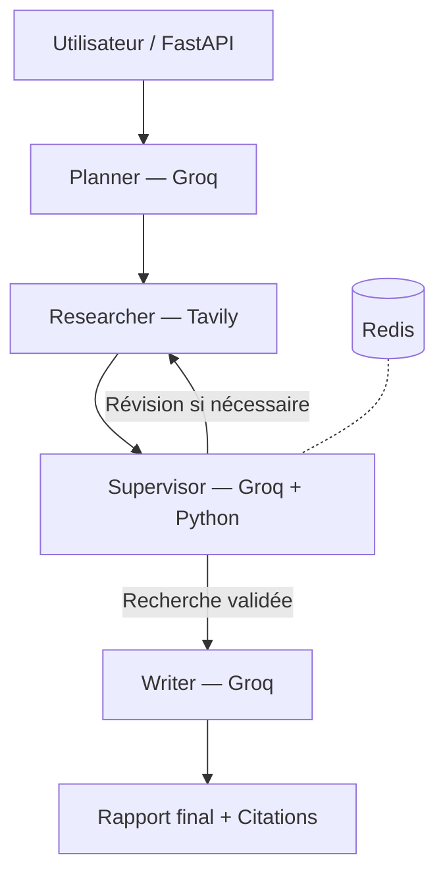

# Multi-Agent Research Assistant

Assistant de recherche multi-agents développé avec **Python 3.12, LangGraph, Groq, Tavily, Redis et FastAPI**. À partir d'une question, il prépare un plan, collecte des sources, évalue la qualité des informations, réalise au besoin une révision ciblée et produit un rapport structuré associé à des citations.

> **État du projet :** implémentation fonctionnelle, validée par 85 tests automatisés et une exécution complète de bout en bout. Le contrôle de validité des références ne constitue pas, à lui seul, une vérification sémantique des affirmations.

## Fonctionnalités

- **Planner (Groq)** : décompose la demande en sous-questions.
- **Researcher (Tavily Search / Extract)** : recherche, extrait et structure les sources, avec déduplication et gestion des erreurs.
- **Supervisor (LangGraph + Reviewer Groq)** : contrôle la pertinence des résultats, transmet un feedback au Researcher, autorise au maximum une révision par sous-question et applique les budgets.
- **Writer (Groq)** : produit un rapport contenant des affirmations reliées à des identifiants de findings.
- **Redis** : conserve les états et checkpoints, les traces, les informations de runs et les compteurs de tokens ; prend en charge l'idempotence et la reprise après interruption.
- **FastAPI** : permet de lancer les recherches et de consulter le statut, le rapport, les citations, les traces et les événements.

## Architecture

Le projet repose sur **quatre agents orchestrés par LangGraph**. FastAPI expose les fonctionnalités et Redis assure la persistance.



- **Planner** : décompose la question en sous-questions.
- **Researcher** : effectue les recherches et l'extraction avec Tavily, puis structure les findings.
- **Supervisor** : évalue la qualité des résultats avec Groq, applique les limites en Python et peut demander **une révision au maximum par sous-question**.
- **Writer** : rédige le rapport et relie ses affirmations aux findings utilisés.
- **Redis** : conserve les checkpoints, traces, états, informations d'idempotence et compteurs de tokens. Il intervient dans plusieurs composants, même si le schéma le relie seulement au Supervisor pour rester lisible.

Le **Researcher peut afficher 0 token Groq** : ses recherches Tavily ne sont pas des appels au modèle Groq. Les détails de reprise après crash, de budgets et de circulation de l'état sont décrits dans [la documentation technique](DOCUMENTATION_TECHNIQUE.md).

## Prérequis

- Python **3.12** (le `pyproject.toml` indique `>=3.12,<3.13`).
- Git.
- Docker Desktop et Docker Compose pour Redis.
- Une clé API **Groq** et une clé API **Tavily**.

## Installation — Windows / PowerShell

```powershell
git clone https://github.com/ELFAHEMmariem/multi-agent-research-assistant.git
cd multi-agent-research-assistant

py -3.12 -m venv .venv
.\.venv\Scripts\Activate.ps1
python -m pip install --upgrade pip
python -m pip install -e ".[dev]"
python -m pip install fastapi uvicorn httpx
```

> Les dépendances FastAPI / Uvicorn / HTTPX sont indiquées séparément car elles ne figurent pas dans les dépendances principales actuellement déclarées dans `pyproject.toml`.

## Configuration

Créer un fichier `.env` à partir du modèle :

```powershell
Copy-Item .env.example .env
notepad .env
```

Renseigner les valeurs :

```dotenv
GROQ_API_KEY=votre_cle_groq
GROQ_MODEL=openai/gpt-oss-20b
TAVILY_API_KEY=votre_cle_tavily
REDIS_URL=redis://localhost:6379

MAX_SUBQUESTIONS=3
MAX_SEARCHES_PER_QUESTION=2
MAX_TOTAL_TOKENS=15000
MAX_REVISIONS=1
MAX_RUN_SECONDS=240
```

Ne jamais committer `.env` ou des clés API. Les limites ci-dessus sont les valeurs utilisées lors de la validation du projet.

## Lancement

Démarrer Redis :

```powershell
docker compose up -d
```

Démarrer l'API dans un autre terminal, avec l'environnement virtuel activé :

```powershell
python -m uvicorn app.api.main:app --host 127.0.0.1 --port 8000
```

Vérifier :

```powershell
Invoke-RestMethod http://127.0.0.1:8000/health
```

Réponse attendue :

```json
{"status":"healthy","redis":"connected"}
```

Documentation interactive de l'API : `http://127.0.0.1:8000/docs`.

## Exemple d'utilisation

Soumettre une question :

```powershell
$body = @{
  question = "What are the main challenges of implementing Zero Trust architecture in enterprises?"
} | ConvertTo-Json

$created = Invoke-RestMethod -Method Post `
  -Uri http://127.0.0.1:8000/research `
  -ContentType 'application/json' `
  -Body $body

$runId = $created.run_id
$runId
```

La création d'un run retourne **HTTP 202**. Consulter son état :

```powershell
Invoke-RestMethod "http://127.0.0.1:8000/research/$runId"
```

Lorsqu'il atteint `completed` :

```powershell
Invoke-RestMethod "http://127.0.0.1:8000/report/$runId"
Invoke-RestMethod "http://127.0.0.1:8000/research/$runId/citations"
Invoke-RestMethod "http://127.0.0.1:8000/research/$runId/trace"
```

## Endpoints

| Méthode | Route | Usage |
|---|---|---|
| `GET` | `/health` | Santé de l'API et connexion Redis |
| `POST` | `/research` | Créer un run de recherche |
| `GET` | `/research/{run_id}` | État de la recherche et message d'erreur éventuel |
| `GET` | `/report/{run_id}` | Rapport final (run terminé) |
| `GET` | `/research/{run_id}/citations` | Citations et contrôle des références |
| `GET` | `/research/{run_id}/trace` | Traces des étapes exécutées |
| `GET` | `/events/{run_id}` | Flux d'événements (SSE) |

Une demande de rapport ou de citations avant la fin d'un run peut retourner **HTTP 409 Conflict**.

## Tests

```powershell
python -m pytest -q
```

**Dernière validation constatée :** `85 passed`.

**Exemple de résultat End-to-End observé :** run `7fb69af2-f7ea-4771-a450-709a0492329c`, état `completed`, rapport/citations/traces accessibles, consommation **12 797 / 15 000 tokens** (Planner 492 ; Supervisor/Reviewer 9 785 ; Writer 2 520 ; Researcher/Groq 0). Il s'agit d'un résultat de validation, pas d'une consommation garantie pour toutes les questions.

## Limites connues

- Les réponses du Reviewer sont générées par un modèle et peuvent différer selon les preuves ; une recommandation de révision n'est pas une preuve d'exactitude.
- La vérification des citations confirme que les références correspondent à des findings existants ; le champ `support_verified=false` indique que le support sémantique n'a **pas** été vérifié automatiquement.
- Les appels Groq et Tavily sont dépendants de leurs services et de leurs limites d'utilisation.
- Le budget de tokens est appliqué au fur et à mesure des appels ; une étape LLM peut dépasser le seuil avant que le contrôle suivant n'arrête le workflow.
- Un run peut finir à `stopped` sans rapport disponible, notamment en cas de dépassement de budget.

## Documentation technique

Voir [DOCUMENTATION_TECHNIQUE.md](DOCUMENTATION_TECHNIQUE.md) pour l'architecture détaillée, les responsabilités des modules, le cycle d'exécution, la persistance, les budgets, l'API et les validations.

## Dépôt

https://github.com/ELFAHEMmariem/multi-agent-research-assistant
